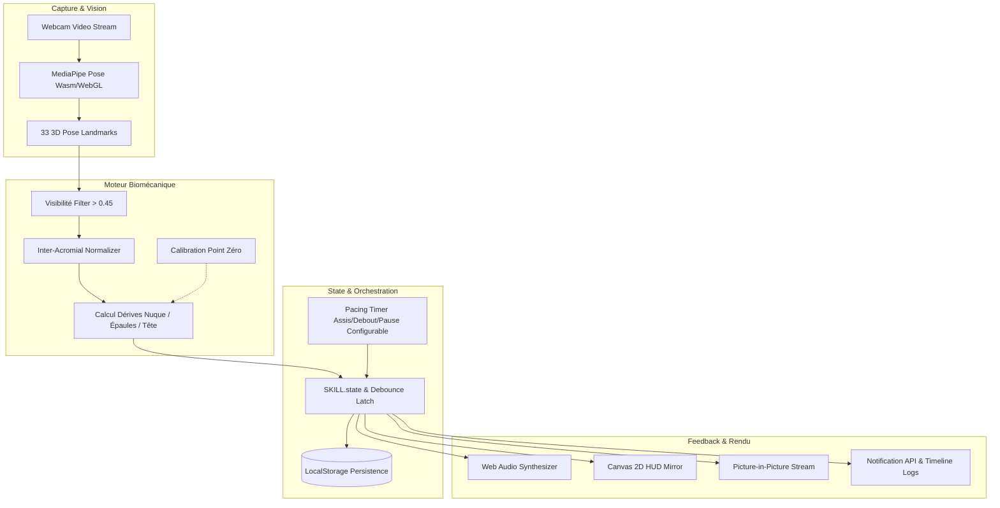

# Design System & Architecture (design.md) — ErgoVision AI

## High-Level Architecture

ErgoVision AI repose sur une architecture Edge Computing 100% exécutée dans le navigateur client, organisée selon les couches suivantes :



---

## Architecture d'Exécution & Cognitive (SKILL.state & Triade)

### 1. Protocole SKILL.state (Exécution Procédurale Scalable)
- **Schéma d'État Canonique ($\Sigma$)** : Défini formellement dans `20_Data_et_Bases/state_schema.json`.
- **Format du Prompt Runtime** :
  ```
  Instructions: {P}
  Skill Execution State: ```json {json.dumps(state)} ```
  Latest Observation: {observation}
  ```
- **Format de Réponse Attendu** :
  1. Raisonnement pas-à-pas $R_t$ (détruit post-exécution).
  2. Bloc JSON contenant :
     ```json
     {
       "state_patch": { "<clé>": "<valeur>", "<clé_a_supprimer>": null },
       "action": "<commande_ou_outil>"
     }
     ```
- **Opérateur de Transition** : $\Sigma_{t+1} = \Sigma_t \oplus \Delta\Sigma_t$ (Validation déterministe + persistance checkpointer).

### 2. Orchestration & Mémoire
- **Flux Métier** : Graphes d'État (Persistance transactionnelle SQLite et validation HITL pour les cycles de sprint).
- **Mémoire Sémantique & Topologie** : Graphes de connaissances (GraphRAG multi-sauts et MCP Graphify pour la topologie du code).

---

## Design System UI/UX (Microsoft Fluent UI 2 — Modern Workstation)
- **Spécification & Tokens** :
  - Spécification complète : [DESIGN_SYSTEM.md](file:///e:/01%20-%20PROJETS/ErgoVision/10_Design_et_Assets/DESIGN_SYSTEM.md)
  - Tokens DTCG JSON : [tokens.json](file:///e:/01%20-%20PROJETS/ErgoVision/10_Design_et_Assets/tokens/tokens.json)
  - Variables CSS Custom Properties : [tokens.css](file:///e:/01%20-%20PROJETS/ErgoVision/10_Design_et_Assets/tokens/tokens.css)
- **Palette & Thèmes (Dark & Light natifs)** :
  - `Brand Accent (Fluent Blue Stop 80/100 #0f6cbd / #479ef5)` : Actions principales et repères de navigation.
  - `Émeraude Clinique (--status-success)` : Posture alignée nominale / Maintien neutre validé.
  - `Ambre Sécurité (--status-warning)` : Pré-alerte posturale / Pacing d'alternance assis-debout.
  - `Rose / Rouge Alerte (--status-danger)` : Alerte active de dérive posturale prolongée (> 2.5s).
- **Accessibilité & Ergonomie Visuelle (WCAG 2.1 AA)** :
  - Contrastes de texte supérieurs à 9:1 (normal) et 4.5:1 (minimum AA).
  - Double focus ring (`--focus-ring-inner` et `--focus-ring-outer`) pour la navigation clavier sans faille.
  - Cibles tactiles calibrées (`>= 34px` desktop, `>= 48px` tactile).
  - Typographie numérique tabulaire (`Bahnschrift` / `Segoe UI`) pour éliminer le jittering des jauges.

